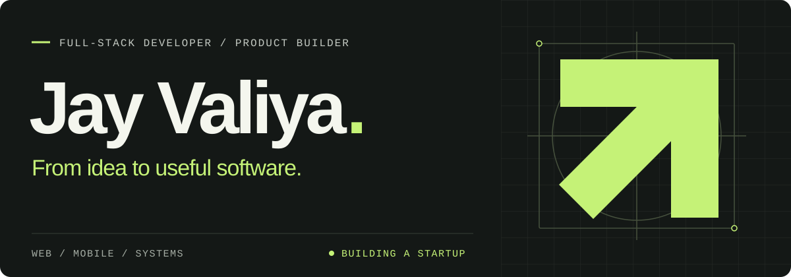

  <a href="https://www.jayvaliya.com"><b>Portfolio ↗</b></a>&nbsp;&nbsp; / &nbsp;&nbsp;
  <a href="https://www.linkedin.com/in/jay-valiya/">LinkedIn</a>&nbsp;&nbsp; / &nbsp;&nbsp;
  <a href="https://x.com/jayvaliya09">X</a>&nbsp;&nbsp; / &nbsp;&nbsp;
  <a href="mailto:valiyajay555@gmail.com">Email</a>

 

## Turning real problems into working products.

I'm Jay, a full-stack developer building for the web and mobile. I like the whole journey from an idea to something people can use, with a soft spot for the backend: clear APIs, thoughtful data models, and systems that hold up beyond the demo.

> **Currently building → a startup for business solutions.**
>
> I'm working on practical software that helps businesses simplify day-to-day operations, automate repetitive work, and get more done. Turning business problems into useful products is where my focus is right now.

Outside that, I experiment with **AI agents that use tools and run real workflows**, explore **Bitcoin internals**, and build things I want to use myself.

 

## Selected work

<table>
  <tr>
    <td width="50%" valign="top">
      <h3><a href="https://github.com/jayvaliya/noter">Noter ↗</a></h3>
      
A home for notes and shared knowledge. Rich text editing, folders, bookmarks, and control over what's public or private.

      
<code>Next.js</code> <code>PostgreSQL</code> <code>Prisma</code>

    </td>
    <td width="50%" valign="top">
      <h3><a href="https://github.com/jayvaliya/medium">BlogPen ↗</a></h3>
      
A blogging platform with rich text editing and a serverless backend running on Cloudflare Workers.

      
<code>React</code> <code>Hono</code> <code>Cloudflare</code>

    </td>
  </tr>
  <tr>
    <td width="50%" valign="top">
      <h3><a href="https://github.com/jayvaliya/skills">Agent Skills ↗</a></h3>
      
Reusable skills I write for coding agents. Practical workflows for tasks like Mac cleanup and making tutorial videos.

      
<code>Claude Code</code> <code>Codex</code> <code>Shell</code>

    </td>
    <td width="50%" valign="top">
      <h3><a href="https://github.com/jayvaliya/crypto-hub">Crypto Hub ↗</a></h3>
      
A cryptocurrency dashboard with live market data from CoinGecko and interactive price charts.

      
<code>React</code> <code>Tailwind CSS</code> <code>ApexCharts</code>

    </td>
  </tr>
</table>

[Explore the rest of my repositories →](https://github.com/jayvaliya?tab=repositories)

 

## My working stack

**Web & mobile** &nbsp; `TypeScript` · `React` · `Next.js` · `React Native` · `Expo`

**Backend & data** &nbsp; `Node.js` · `Hono` · `PostgreSQL` · `Prisma` · `Redis`

**Shipping** &nbsp; `Docker` · `GitHub Actions` · `Cloudflare` · `Vercel`

 

---

**Working on something useful?** I'm up for conversations about business software, AI agents, and open source. [Let's talk ↗](mailto:valiyajay555@gmail.com)
